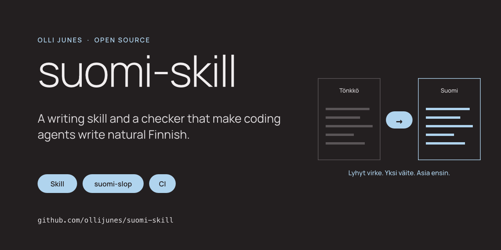

# suomi-skill



[](https://github.com/ollijunes/suomi-skill/actions/workflows/ci.yml)
[](pyproject.toml)
[](LICENSE)

A writing skill that makes coding agents write natural Finnish, and
`suomi-slop`, a checker that finds the patterns of machine-written and
translated Finnish in your text.

[Lue suomeksi](README.fi.md)

Language models write Finnish that is grammatically fine and still wrong.
It is English with Finnish words: a possessive pronoun on every noun,
"in the long run" translated word for word, three adjectives in a row, an
exclamation mark where a Finn would put a full stop. A Finnish reader spots
it in one sentence and stops trusting the page.

This repository has two parts that work alone or together:

- **[`skills/suomi/SKILL.md`](skills/suomi/SKILL.md)** tells an agent how to
  write Finnish: registers from chat to press release, sentence structure,
  grammar traps, banned patterns, translated idioms and their Finnish
  equivalents, and before-and-after pairs. It is written in Finnish.
- **`suomi-slop`** reads Markdown, MDX, Astro, HTML and text files, lists
  what it finds with line numbers and advice, and scores each file from 0
  to 10. It runs in a terminal, a pre-commit hook or CI.

[Security](SECURITY.md) · [Contributing](CONTRIBUTING.md) ·
[ollijunes.com](https://ollijunes.com)

## Who it is for

People who let an agent write or edit Finnish: website copy, blog posts,
interface text, documentation, emails. Also people who review Finnish text
produced by someone else's agent.

## Use the skill

With Claude Code, copy the folder to your personal skills:

```sh
git clone https://github.com/ollijunes/suomi-skill
cp -R suomi-skill/skills/suomi ~/.claude/skills/suomi
```

Claude Code loads it when you ask for Finnish text. With another agent,
point its instruction file at the skill, for example in `AGENTS.md`:

```markdown
When you write or edit Finnish, read and follow skills/suomi/SKILL.md first.
```

Fill in the section "Omat tiedot" at the end of the skill with your own
names, facts and banned words. An agent that is not told a fact invents
one.

## Use the checker

You need Python 3.11 or newer. There are no other dependencies.

```sh
uv tool install git+https://github.com/ollijunes/suomi-skill
suomi-slop content/
```

`pipx install git+https://github.com/ollijunes/suomi-skill` works too.

```text
examples/slop.md: 0,0/10, kirjoita uudelleen (104 sanaa)
  rivi 5: emoji (vakava): 🚲
    Poista emojit asiatekstistä.
  rivi 7: geneerinen-johdanto (vakava): Tässä artikkelissa käsittelemme
    Aloita asialla: kerro ensimmäisessä virkkeessä se, mitä lukija tuli hakemaan.
  rivi 11: kaannoskukkanen (vältettävä): Pitkässä juoksussa
    Sano suomeksi: ”pitkällä aikavälillä”, ”kannattaa”, ”on järkevää”.
  ...
examples/hyva.md: 10,0/10, julkaisukelpoinen (98 sanaa)
2 tiedostoa, keskiarvo 5,0/10
```

The two files in [`examples/`](examples) say the same thing about oiling a
bicycle chain. Output is in Finnish, because the people who fix the text
read Finnish.

| Command | What it does |
| --- | --- |
| `suomi-slop FILE_OR_FOLDER...` | Report, worst file first |
| `suomi-slop -` | Read text from standard input |
| `--min-score 8` | Exit with code 1 when a file scores below 8. For CI and hooks |
| `--below 6` | List only files below 6 |
| `--all` | Show every finding, not the first twelve |
| `--json` | Machine-readable report |
| `--rules` | List the rules with an example and advice for each |

In CI:

```yaml
- run: uvx --from git+https://github.com/ollijunes/suomi-skill suomi-slop src/content --min-score 8
```

### What it looks for

Sixteen rules on three levels. `--rules` prints them all.

| Level | Cost | Examples |
| --- | --- | --- |
| vakava (serious) | 2.0 each | "Tässä artikkelissa käsittelemme", emoji, exclamation marks in body text, "toivottavasti tästä oli apua" |
| vältettävä (avoid) | 0.5 each | filler ("kannattaa muistaa"), empty metaphors, inflated adjectives, translated idioms ("pitkässä juoksussa"), compound errors ("alunperin"), consultant words |
| epäilyttävä (suspicious) | 0.2 each | "ei vain X vaan Y", denial followed by declaration, three-word rhythm lists, passive filler |

Density checks on the whole text: dashes per thousand words, the word
"tärkeä", the word "kriittinen", and subheadings that all start with the
same word. One real list of three and one "ei vain X vaan Y" are free or
nearly free; repeating them costs more.

Front matter, code blocks, inline code, HTML comments, link addresses,
block quotes, and `<script>` and `<style>` are not checked. To quote a bad
example on purpose, end the line with `<!-- suomi-slop: ohita -->` or wrap
a section:

```markdown
<!-- suomi-slop: ohita-alku -->
| Tönkkö | Korjattu |
<!-- suomi-slop: ohita-loppu -->
```

| Score | Label |
| --- | --- |
| 8.0–10 | julkaisukelpoinen (ready) |
| 6.0–7.9 | pieniä korjauksia (small fixes) |
| 4.0–5.9 | vaatii korjauksia (needs work) |
| under 4 | kirjoita uudelleen (rewrite) |

## Limitations

- It is not an AI detector. People wrote these patterns long before
  language models did. A low score says the text reads like filler, not
  who wrote it.
- It matches patterns. It does not parse Finnish, so it misses inflected
  forms it has no pattern for and flags some honest sentences. A list of
  three real things matches the rhythm rule; that is why the first ones
  are free.
- A score of 10 means none of the patterns was found. The text can still
  be empty, wrong or dull.
- It does not check facts, spelling in general, or grammar beyond a few
  common compound errors.
- The rules fit expository and marketing text. Fiction, poetry and chat
  logs will score oddly.
- The skill reflects one writer's taste in plain Finnish. Edit it to fit
  yours.

## Development

```sh
uv sync --locked
uv run python -m pytest --cov=suomi_slop --cov-fail-under=90
uv run ruff check .
uv run ruff format --check .
uv run suomi-slop skills README.fi.md examples/hyva.md --min-score 8
python3 scripts/check_public_tree.py
```

## License

[MIT](LICENSE). Made by [Olli Junes](https://ollijunes.com). Powered by [ResaHost](https://resahost.net/en/). Not affiliated
with Anthropic.
